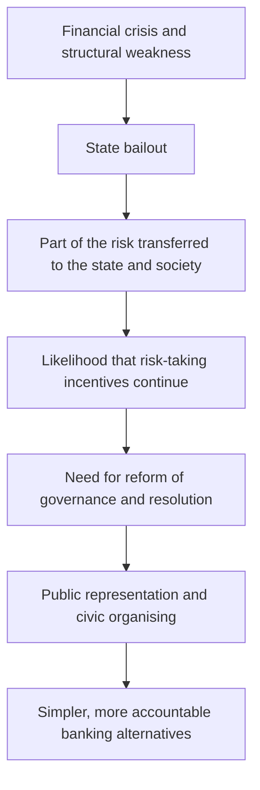

# Lipstick on a Pig: Why Bail-outs Fail and People Power Will Succeed

## *Lipstick on a Pig: Why Bail-outs Fail and People Power Will Succeed*

> [!important] A bibliographic distinction
> This book is by **Simon Deane-Johns** and dates from **2012**. It differs from the book of the same title, *Lipstick on a Pig: Winning in the No-Spin Era*, by **Torie Clarke** (2006). The two books use a shared metaphor, but their subject and argument are separate.

## 1. Book profile

- **Author:** Simon Deane-Johns, co-founder of Zopa and a writer focusing on financial services and institutional change.
- **Publisher:** Searching Finance, Limited.
- **Year of publication:** 2012.
- **Length of the listed edition:** 124 pages.
- **Structure as described on Google Books:** five chapters.
- **Field:** banking, financial regulation, political economy, civil institutions and organisational alternatives.

Bibliographic source: [Google Books](https://books.google.com/books/about/Lipstick_on_a_Pig.html?id=eqKSpwAACAAJ). The description presents the book as the first title in a series about the changing relationship between society and institutions, the personalisation of services and participatory structures.

## 2. The book's central thesis

Based on the concept summaries in these notes, the book's thesis is that government financial aid to banks in crisis may preserve the very structures that helped cause the crisis, while part of the cost is passed to society and the incentive for deep reform declines. The metaphor "lipstick on a pig" is the name for this critique: a change of appearance does not fix a structural defect.

Against this situation the author stresses people power, civic organising, representation of the public interest, and financial models with a simpler, more accountable mission. This part is the author's policy position; to judge its credibility it has to be compared with the evidence on each bailout programme and on institutional alternatives.

## 3. Overall structure according to the bibliographic information

The Google Books information says the book is organised in five chapters:

1. The rise of pragmatism from a bottom-up desire to find what really works;
2. The distinction between "institutions" that mostly solve their own problems and "facilitators" that focus on the customer's problem;
3. The economic environment of the financial system, including greed, human error and a shortage of critical thinking;
4. The transformation of financial services against the background of social and institutional change;
5. A critique of financial regulation and proposed changes for the growth of simple, low-cost, useful financial services.

This structure is quoted from the bibliographic description; the detailed list of sub-headings of each chapter was not available in the underlying summary.

## 4. Independent concept notes

### The metaphor and structural critique
- [[lipstick-on-a-pig-superficial-reform|Lipstick on a Pig / Superficial Reform]]
- [[bail-outs-bank-bailouts|Bail-outs / Bank Bailouts]]
- [[privatization-of-gains-and-socialization-of-losses|Privatization of Gains and Socialization of Losses]]
- [[fair-value-costs-valuation-of-bailouts|Fair Value Costs / Valuation of Bailouts]]
- [[direct-beneficiaries-of-bailouts|Direct Beneficiaries of Bailouts]]

### Risk and banking structure
- [[bank-sovereign-doom-loop|Bank–Sovereign Doom Loop]]
- [[moral-hazard|Moral Hazard]]
- [[too-big-to-fail-tbtf|Too Big to Fail (TBTF)]]
- [[orderly-resolution-of-failing-banks|Orderly Resolution of Failing Banks]]

### Democratic and public alternatives
- [[people-power-community-organizing|People Power / Community Organizing]]
- [[public-ownership-democratic-buyout|Public Ownership / Democratic Buyout]]
- [[public-interest-representation|Public Interest Representation]]
- [[collective-action-problems-civil-society-organizations|Collective Action Problems / Civil Society Organizations]]
- [[stakeholder-banking-boring-banking|Stakeholder Banking / Boring Banking]]
- [[public-narrative-marshall-ganz|Public Narrative / Marshall Ganz]]
- [[broader-value-beyond-gdp|Broader Value Beyond GDP]]
- [[club-goods-free-riders|Club Goods / Free Riders]]

### Institutional orientation
- [[institutions-vs-facilitators|Institutions vs. Facilitators]]
- [[pragmatism-bottom-up-institutional-change|Pragmatism / Bottom-up Institutional Change]]

## 5. The argument at a glance

This diagram is an analytical reconstruction of the underlying summary, not an official diagram printed in the book.

## 6. Critical considerations: the author's thesis against independent evidence

### 6.1. A bailout is not a single instrument

Public aid can take different forms: an investment in a bank, a debt guarantee, an emergency loan, an asset purchase or support for depositors. An assessment should specify which instrument was used and what its cost and conditions were.

### 6.2. A gross amount is not the final cost

GAO reports that by the end of the TARP programme on 30 September 2023, total disbursements were $443.5 billion, and the net final cost of programmes funded from TARP, after repayments, asset sales, dividends, interest and other income, was $31.1 billion. An important part of the final cost related to mortgage foreclosure-prevention programmes, support for AIG and the auto industry; some transactions with financial institutions also ended in a net profit for the government through income and capital gains.

These figures do not refute the book's critique; they show that the broad claim "all bailouts fail" cannot be proved from the gross amount of aid alone. The effect on financial stability, the distribution of benefits, the opportunity cost and long-term consequences have to be examined separately.

### 6.3. The bank–sovereign loop is analytically real, but its mechanism has several factors

The IMF explains that the condition of banks and governments can be transmitted to each other through banks' assets, public guarantees, funding cost and economic recession, producing negative feedback loops.

### 6.4. Public ownership is no guarantee of success

Public banks can pursue development and environmental goals, but their performance depends on governance, capacity, representation, transparency and accountability. Research on public banks stresses that these institutions are not inherently good or bad.

## 7. Questions for critical study

- Was the aim of the rescue to keep shareholders afloat, or to protect depositors and payment infrastructure?
- Who received aid in each programme and who suffered losses?
- Did the state set conditions for restructuring, change of management or limiting risk?
- How do gross cost, the government's net financial cost and the social cost differ?
- Which public or civic body really represents depositors, borrowers and employees?
- By what indicators should private, cooperative and public banks be compared?
- Is the author's claim about one particular country or crisis generalisable to other countries and periods?

## 8. Selected sources

1. [Google Books: profile and description of the book](https://books.google.com/books/about/Lipstick_on_a_Pig.html?id=eqKSpwAACAAJ)
2. [U.S. GAO: the final cost of the TARP programme, December 2023](https://www.gao.gov/products/gao-24-107033)
3. [Congressional Budget Office: TARP report, April 2023](https://www.cbo.gov/publication/59062)
4. [Financial Stability Board: ending Too-Big-To-Fail](https://www.fsb.org/work-of-the-fsb/market-and-institutional-resilience/post-2008-financial-crisis-reforms/ending-too-big-to-fail/)
5. [IMF: the bank–sovereign link](https://www.elibrary.imf.org/view/journals/087/2018/016/article-A001-en.xml)
6. [IMF Global Financial Stability Report: bank–sovereign link](https://www.imf.org/en/publications/gfsr/issues/2022/04/19/global-financial-stability-report-april-2022)
7. [Marshall Ganz et al.: public narrative and collective action, 2023](https://www.hks.harvard.edu/publications/crafting-public-narrative-enable-collective-action-pedagogy-leadership-development)
8. [Cambridge University Press: Public Banks](https://www.cambridge.org/core/books/public-banks/0EC8E41F837E1F10BE53FC31DA83D012)

#book #political-economy #banking #financial-crisis #people-power
