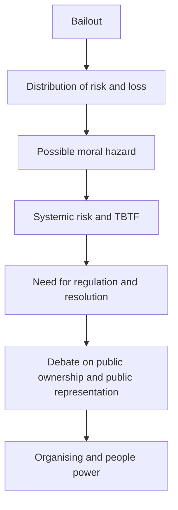

# Concept and Relations Matrix: Lipstick on a Pig (Finance)

| Cluster | Concept | English term | Main link |
|---|---|---|---|
| Structural critique | [[lipstick-on-a-pig-superficial-reform|Lipstick on a Pig / Superficial Reform]] | Lipstick on a Pig | [[bail-outs-bank-bailouts|Bail-outs / Bank Bailouts]] |
| Intervention policy | [[bail-outs-bank-bailouts|Bail-outs / Bank Bailouts]] | Bail-outs | [[privatization-of-gains-and-socialization-of-losses|Privatization of Gains and Socialization of Losses]] |
| Distribution | [[privatization-of-gains-and-socialization-of-losses|Privatization of Gains and Socialization of Losses]] | Socialization of Losses | [[fair-value-costs-valuation-of-bailouts|Fair Value Costs / Valuation of Bailouts]] |
| Cost assessment | [[fair-value-costs-valuation-of-bailouts|Fair Value Costs / Valuation of Bailouts]] | Fair Value Costs | [[direct-beneficiaries-of-bailouts|Direct Beneficiaries of Bailouts]] |
| Benefit distribution | [[direct-beneficiaries-of-bailouts|Direct Beneficiaries of Bailouts]] | Direct Beneficiaries | [[public-interest-representation|Public Interest Representation]] |
| Macro risk | [[bank-sovereign-doom-loop|Bank–Sovereign Doom Loop]] | Bank-Sovereign Doom Loop | [[bail-outs-bank-bailouts|Bail-outs / Bank Bailouts]] |
| Incentives | [[moral-hazard|Moral Hazard]] | Moral Hazard | [[too-big-to-fail-tbtf|Too Big to Fail (TBTF)]] |
| Market concentration | [[too-big-to-fail-tbtf|Too Big to Fail (TBTF)]] | Too Big to Fail | [[orderly-resolution-of-failing-banks|Orderly Resolution of Failing Banks]] |
| Alternative governance | [[public-ownership-democratic-buyout|Public Ownership / Democratic Buyout]] | Public Ownership | [[stakeholder-banking-boring-banking|Stakeholder Banking / Boring Banking]] |
| Social action | [[people-power-community-organizing|People Power / Community Organizing]] | People Power | [[collective-action-problems-civil-society-organizations|Collective Action Problems / Civil Society Organizations]] |
| Representation | [[public-interest-representation|Public Interest Representation]] | Public Interest Representation | [[club-goods-free-riders|Club Goods / Free Riders]] |
| Leadership | [[public-narrative-marshall-ganz|Public Narrative / Marshall Ganz]] | Public Narrative | [[people-power-community-organizing|People Power / Community Organizing]] |
| Value | [[broader-value-beyond-gdp|Broader Value Beyond GDP]] | Beyond GDP | [[stakeholder-banking-boring-banking|Stakeholder Banking / Boring Banking]] |
| Institutional design | [[institutions-vs-facilitators|Institutions vs. Facilitators]] | Institutions vs Facilitators | [[pragmatism-bottom-up-institutional-change|Pragmatism / Bottom-up Institutional Change]] |

## The main conceptual loop

This diagram is an analytical synthesis of the concepts and secondary sources; it is not the author's official diagram.
