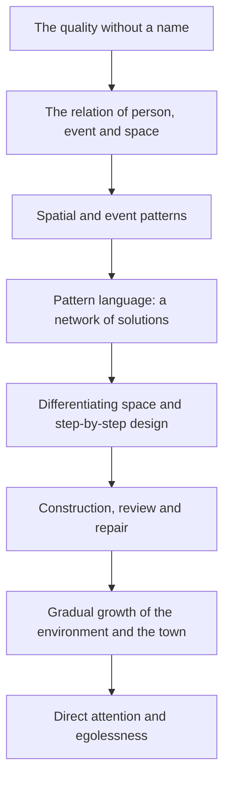

# The Timeless Way of Building

## The Timeless Way of Building: Christopher Alexander

## 1. Book profile

- **English title:** *The Timeless Way of Building*
- **Persian title:** راه و رسم بی‌زمان ساختن
- **Author:** Christopher Alexander
- **Year of publication:** 1979
- **Publisher of the known edition:** Oxford University Press
- **Series:** Center for Environmental Structure
- **Structure:** an opening chapter and four main parts; 27 chapters in all.

The book offers a theory of architecture, construction and planning whose centre is a process by which the order of an environment forms from people's needs, experience and being, and from the real conditions of the place. Conceptually the work is linked with *A Pattern Language* and *The Oregon Experiment*.

> [!note] Conceptual order and publication order
> The three works lie along one theoretical path but were not published in that order: *The Oregon Experiment* (1975), *A Pattern Language* (1977) and *The Timeless Way of Building* (1979). This book sets out the theoretical foundations of the approach, even though it was the last of the three to appear.

## 2. Central thesis

Alexander argues that a quality of life, coherence and fit can appear in buildings and cities, and that it is not produced by imposing a formal image from outside or by choosing a visual style alone. In his theory this quality arises from a process that links human needs, the conditions of the place, materials, activities and recurring patterns.

Guiding ideas:

1. The quality that matters in an environment cannot be reduced to a single criterion or word.
2. An environment is both physical space and the setting in which human events happen.
3. Patterns are solutions to recurring problems, but they only mean something in context and in relation to other patterns.
4. A pattern language can generate design options and learn from collective experience.
5. Living design is a gradual, context-bound process that can be revised; maintenance and change are part of an environment's life too.
6. Design rules are tools, not a substitute for responsible judgement and direct attention to the real situation.

## 3. Structure of the book

| Part | Chapters | Subject |
|---|---:|---|
| The Timeless Way (opening chapter) | 1 | First formulation of the timeless way |
| The Quality | 2–8 | The quality without a name, being alive, events, space and patterns |
| The Gate | 9–17 | The pattern language, its structure, sharing and evolution |
| The Way | 18–26 | Design, construction, repair and the gradual growth of a town |
| The Kernel of the Way | 27 | The theoretical kernel of the path and moving beyond mechanical reliance on instructions |

### Chapter list and start page in the English edition

| Chapter | English title | Start page |
|---:|---|---:|
| 1 | The Timeless Way | 3 |
| 2 | The Quality Without a Name | 19 |
| 3 | Being Alive | 41 |
| 4 | Patterns of Events | 55 |
| 5 | Patterns of Space | 75 |
| 6 | Patterns Which Are Alive | 101 |
| 7 | The Multiplicity of Living Patterns | 123 |
| 8 | The Quality Itself | 137 |
| 9 | The Flower and the Seed | 157 |
| 10 | Our Pattern Languages | 167 |
| 11 | Our Pattern Languages (cont.) | 193 |
| 12 | The Creative Power of Language | 211 |
| 13 | The Breakdown of Language | 225 |
| 14 | Patterns Which Can Be Shared | 243 |
| 15 | The Reality of Patterns | 277 |
| 16 | The Structure of a Language | 305 |
| 17 | The Evolution of a Common Language for a Town | 325 |
| 18 | The Genetic Power of Language | 351 |
| 19 | Differentiating Space | 365 |
| 20 | One Pattern at a Time | 385 |
| 21 | Shaping One Building | 403 |
| 22 | Shaping a Group of Buildings | 427 |
| 23 | The Process of Construction | 455 |
| 24 | The Process of Repair | 475 |
| 25 | The Slow Emergence of a Town | 493 |
| 26 | Its Ageless Character | 511 |
| 27 | The Kernel of the Way | 531 |

The pages are the chapter start pages in the table of contents of the English edition; they may differ in a translation or another printing.

## 4. Map of the independent notes

- [[the-timeless-way|The Timeless Way]]
- [[the-quality-without-a-name|The Quality Without a Name]]
- [[alive-whole-comfortable-free-exact-egoless-eternal|Alive, Whole, Comfortable, Free, Exact, Egoless, Eternal]]
- [[being-alive-self-supporting-quality|Being Alive / Self-Supporting Quality]]
- [[patterns-of-events|Patterns of Events]]
- [[patterns-of-space|Patterns of Space]]
- [[patterns-which-are-alive-multiplicity-of-living-patterns|Patterns Which Are Alive / Multiplicity of Living Patterns]]
- [[character-of-nature-vs-modular-construction|Character of Nature vs. Modular Construction]]
- [[consciousness-of-death-and-transitoriness|Consciousness of Death and Transitoriness]]
- [[pattern-language|Pattern Language]]
- [[the-breakdown-of-language|The Breakdown of Language]]
- [[the-structure-of-a-language|The Structure of a Language]]
- [[common-pattern-pool-evolution-of-a-common-language|Common Pattern Pool / Evolution of a Common Language]]
- [[differentiating-space|Differentiating Space]]
- [[one-pattern-at-a-time|One Pattern at a Time]]
- [[shaping-one-building-shaping-a-group-of-buildings|Shaping One Building / Shaping a Group of Buildings]]
- [[the-process-of-construction|The Process of Construction]]
- [[the-process-of-repair|The Process of Repair]]
- [[the-slow-emergence-of-a-town|The Slow Emergence of a Town]]
- [[its-ageless-character|Its Ageless Character]]
- [[the-kernel-of-the-way-egolessness|The Kernel of the Way / Egolessness]]

## 5. The line of argument at a glance

This diagram is a compact reconstruction of the line of thought, not the book's official diagram. Users' experience and later repairs can change patterns; so the feedback loop matters too.

## 6. Basic distinctions

- **Timeless is not the same as historical:** the aim is not to copy the look of old buildings; the claim is that quality should arise from fit with people and place.
- **A pattern is not a module:** a pattern is a relation that answers a problem; a module is a standardised unit. The two can be used together.
- **A pattern language is not a list of ideas:** the links and the order of dependence among patterns are an important part of the language.
- **Gradual growth is not the absence of planning:** infrastructure and general frameworks can go along with local flexibility.
- **Egolessness is not irresponsibility:** professional humility does not remove responsibilities for safety, law and quality.

## 7. Critical margins

Some presuppositions of the theory are open to criticism: is the quality without a name objective and shared across all cultures? How can it be measured in a repeatable way? How can the designer's personal preference be separated from a universal claim? When does local growth help flexibility, and when is large-scale coordination necessary?

These questions do not refute the theory automatically; they show that applying it needs a clear formulation, attention to context and empirical evidence.

## Sources

1. Alexander, Christopher. *The Timeless Way of Building*. Oxford University Press, 1979. [Book listing and information](https://openlibrary.org/books/OL26014569M/The_Timeless_Way_of_Building)
2. Dawes, Michael J., and Michael J. Ostwald. "Christopher Alexander's A Pattern Language: analysing, mapping and classifying the critical response." *City, Territory and Architecture* (2017). [Research article](https://link.springer.com/article/10.1186/s40410-017-0073-1)
3. [Christopher Alexander's Battle for Beauty in a World Turning Ugly](https://www.sciencedirect.com/science/article/pii/S2405872620300459)

#book #architecture #urbanism #christopher-alexander #pattern-language
