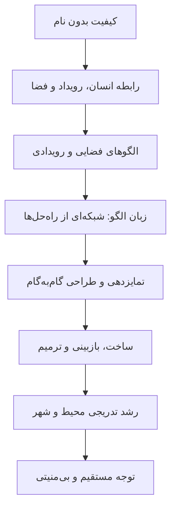

# راه و رسم بی‌زمان ساختن
## The Timeless Way of Building — Christopher Alexander

## ۱. شناسنامه کتاب

- **عنوان انگلیسی:** *The Timeless Way of Building*
- **عنوان فارسی:** راه و رسم بی‌زمان ساختن
- **نویسنده:** Christopher Alexander
- **سال انتشار:** ۱۹۷۹
- **ناشر نسخه شناخته‌شده:** Oxford University Press
- **مجموعه:** Center for Environmental Structure
- **ساختار:** یک فصل آغازین و چهار بخش اصلی؛ مجموعاً ۲۷ فصل.

این کتاب نظریه‌ای درباره معماری، ساخت‌وساز و برنامه‌ریزی عرضه می‌کند که مرکز آن فرایندی برای شکل‌گیری نظم محیط از نیازها، تجربه و وجود انسان‌ها و شرایط واقعی مکان است. اثر از نظر مفهومی با *A Pattern Language* و *The Oregon Experiment* مرتبط است.

> [!note] ترتیب مفهومی و ترتیب انتشار
> سه اثر در یک مسیر نظری قرار دارند، اما به ترتیب زمانی منتشر نشده‌اند: *The Oregon Experiment* (۱۹۷۵)، *A Pattern Language* (۱۹۷۷) و *The Timeless Way of Building* (۱۹۷۹). کتاب حاضر مبانی نظری رویکرد را بیان می‌کند، هرچند از آن سه اثر آخر منتشر شد.

## ۲. تز مرکزی

الکساندر استدلال می‌کند که کیفیتی از حیات، انسجام و تناسب می‌تواند در بناها و شهرها پدیدار شود که با تحمیل تصویر فرمی از بیرون یا انتخاب سبک ظاهری به‌تنهایی حاصل نمی‌شود. این کیفیت، در نظریه او، از فرایندی پدید می‌آید که میان نیازهای انسان، شرایط مکان، مصالح، فعالیت‌ها و الگوهای تکرارشونده رابطه برقرار می‌کند.

ایده‌های راهنما:

1. کیفیت مهم محیط به یک معیار یا واژه منفرد فروکاستنی نیست.
2. محیط هم فضای فیزیکی است و هم زمینه وقوع رویدادهای انسانی.
3. الگوها راه‌حل‌هایی برای مسائل تکرارشونده‌اند، اما فقط در زمینه و در ارتباط با الگوهای دیگر معنا دارند.
4. زبان الگو می‌تواند گزینه‌های طراحی بسازد و از تجربه جمعی بیاموزد.
5. طراحی زنده فرایندی تدریجی، زمینه‌مند و قابل اصلاح است؛ نگهداری و تغییر نیز بخشی از حیات محیط‌اند.
6. قواعد طراحی ابزارند، نه جایگزین قضاوت مسئولانه و توجه مستقیم به موقعیت واقعی.

## ۳. ساختار کتاب

| بخش | فصل‌ها | موضوع |
|---|---:|---|
| The Timeless Way (فصل آغازین) | ۱ | صورت‌بندی اولیه راه و رسم بی‌زمان |
| The Quality | ۲–۸ | کیفیت بدون نام، زنده بودن، رویدادها، فضا و الگوها |
| The Gate | ۹–۱۷ | زبان الگو، ساختار، اشتراک و تحول آن |
| The Way | ۱۸–۲۶ | طراحی، ساخت، ترمیم و رشد تدریجی شهر |
| The Kernel of the Way | ۲۷ | هسته نظری مسیر و فرارفتن از اتکای مکانیکی به دستورها |

### فهرست فصل‌ها و صفحه آغاز در نسخه انگلیسی

| فصل | عنوان انگلیسی | صفحه آغاز |
|---:|---|---:|
| ۱ | The Timeless Way | ۳ |
| ۲ | The Quality Without a Name | ۱۹ |
| ۳ | Being Alive | ۴۱ |
| ۴ | Patterns of Events | ۵۵ |
| ۵ | Patterns of Space | ۷۵ |
| ۶ | Patterns Which Are Alive | ۱۰۱ |
| ۷ | The Multiplicity of Living Patterns | ۱۲۳ |
| ۸ | The Quality Itself | ۱۳۷ |
| ۹ | The Flower and the Seed | ۱۵۷ |
| ۱۰ | Our Pattern Languages | ۱۶۷ |
| ۱۱ | Our Pattern Languages (cont.) | ۱۹۳ |
| ۱۲ | The Creative Power of Language | ۲۱۱ |
| ۱۳ | The Breakdown of Language | ۲۲۵ |
| ۱۴ | Patterns Which Can Be Shared | ۲۴۳ |
| ۱۵ | The Reality of Patterns | ۲۷۷ |
| ۱۶ | The Structure of a Language | ۳۰۵ |
| ۱۷ | The Evolution of a Common Language for a Town | ۳۲۵ |
| ۱۸ | The Genetic Power of Language | ۳۵۱ |
| ۱۹ | Differentiating Space | ۳۶۵ |
| ۲۰ | One Pattern at a Time | ۳۸۵ |
| ۲۱ | Shaping One Building | ۴۰۳ |
| ۲۲ | Shaping a Group of Buildings | ۴۲۷ |
| ۲۳ | The Process of Construction | ۴۵۵ |
| ۲۴ | The Process of Repair | ۴۷۵ |
| ۲۵ | The Slow Emergence of a Town | ۴۹۳ |
| ۲۶ | Its Ageless Character | ۵۱۱ |
| ۲۷ | The Kernel of the Way | ۵۳۱ |

صفحه‌ها، صفحه آغاز فصل در فهرست نسخه انگلیسی‌اند؛ ممکن است در ترجمه یا چاپ دیگر متفاوت باشند.

## ۴. نقشه یادداشت‌های مستقل

- [[راه و رسم بی‌زمان]]
- [[کیفیت بدون نام]]
- [[هفت وصف کیفیت بدون نام]]
- [[زنده بودن انسان و محیط]]
- [[الگوهای رویدادها]]
- [[الگوهای فضایی]]
- [[الگوهای زنده و چندگانگی الگوها]]
- [[طبیعت، تکرار و ماژولار بودن]]
- [[کهنگی، فرسایش و فانی بودن]]
- [[زبان الگو]]
- [[فروپاشی زبان‌های الگو]]
- [[ساختار و کامل بودن زبان الگو]]
- [[حوضچه مشترک الگوها و تکامل شهری]]
- [[تمایزدهی و شکفتن فضا]]
- [[طراحی یک الگو در هر گام]]
- [[شکل دادن به ساختمان و گروه ساختمان‌ها]]
- [[ساخت مستقیم در سایت]]
- [[فرایند ترمیم و بازسازی تدریجی]]
- [[رشد تدریجی شهر]]
- [[شخصیت بی‌زمان]]
- [[هسته راه و بی‌منیتی]]

## ۵. خط استدلال در یک نگاه

این نمودار بازسازی فشرده مسیر فکری است، نه نمودار رسمی کتاب. تجربه کاربران و تعمیرات بعدی می‌توانند الگوها را تغییر دهند؛ بنابراین چرخه بازخورد نیز مهم است.

## ۶. تمایزهای اساسی

- **بی‌زمان با تاریخی یکی نیست:** هدف، کپی ظاهر بناهای قدیمی نیست؛ ادعا این است که کیفیت از تناسب با انسان و مکان پدید آید.
- **الگو با ماژول یکی نیست:** الگو رابطه‌ای برای پاسخ به مسئله است؛ ماژول واحدی استانداردشده است. این دو می‌توانند با هم به‌کار روند.
- **زبان الگو با فهرست ایده‌ها یکی نیست:** ارتباط و ترتیب وابستگی میان الگوها بخش مهمی از زبان است.
- **رشد تدریجی با نبود برنامه‌ریزی یکی نیست:** زیرساخت‌ها و چارچوب‌های عمومی می‌توانند با انعطاف محلی همراه باشند.
- **بی‌منیتی با بی‌مسئولیتی یکی نیست:** فروتنی حرفه‌ای مسئولیت‌های ایمنی، قانون و کیفیت را حذف نمی‌کند.

## ۷. حواشی انتقادی

برخی پیش‌فرض‌های نظریه محل نقدند: آیا کیفیت بدون نام برای همه فرهنگ‌ها عینی و مشترک است؟ چگونه می‌توان آن را به‌شکلی قابل تکرار سنجید؟ چگونه ترجیح شخصی طراح از ادعای جهان‌شمول جدا می‌شود؟ چه زمانی رشد محلی به انعطاف کمک می‌کند و چه زمانی هماهنگی کلان ضروری است؟

این پرسش‌ها نظریه را خودبه‌خود رد نمی‌کنند؛ نشان می‌دهند کاربرد آن به صورت‌بندی روشن، توجه به زمینه و شواهد تجربی نیاز دارد.

## منابع

1. Alexander, Christopher. *The Timeless Way of Building*. Oxford University Press, 1979. [فهرست و اطلاعات کتاب](https://openlibrary.org/books/OL26014569M/The_Timeless_Way_of_Building)
2. Dawes, Michael J., and Michael J. Ostwald. “Christopher Alexander’s A Pattern Language: analysing, mapping and classifying the critical response.” *City, Territory and Architecture* (2017). [متن پژوهش](https://link.springer.com/article/10.1186/s40410-017-0073-1)
3. [Christopher Alexander’s Battle for Beauty in a World Turning Ugly](https://www.sciencedirect.com/science/article/pii/S2405872620300459)

#کتاب #معماری #شهرسازی #کریستوفر-الکساندر #زبان-الگو
