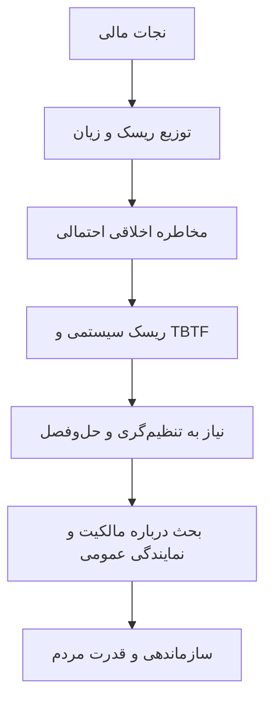

# ماتریس مفاهیم و روابط — ماتیک روی خوک مالی

| خوشه | مفهوم | اصطلاح انگلیسی | ارتباط اصلی |
|---|---|---|---|
| نقد ساختاری | [[استعاره رژ لب روی خوک در نظام مالی]] | Lipstick on a Pig | [[نجات مالی بانک‌ها]] |
| سیاست مداخله | [[نجات مالی بانک‌ها]] | Bail-outs | [[خصوصی‌سازی سود و اجتماعی‌سازی زیان]] |
| توزیع | [[خصوصی‌سازی سود و اجتماعی‌سازی زیان]] | Socialization of Losses | [[هزینه واقعی نجات مالی و ارزش‌گذاری]] |
| ارزیابی هزینه | [[هزینه واقعی نجات مالی و ارزش‌گذاری]] | Fair Value Costs | [[ذی‌نفعان واقعی نجات مالی]] |
| توزیع منافع | [[ذی‌نفعان واقعی نجات مالی]] | Direct Beneficiaries | [[نمایندگی منافع عمومی در بانکداری]] |
| ریسک کلان | [[چرخه بانک و دولت]] | Bank-Sovereign Doom Loop | [[نجات مالی بانک‌ها]] |
| انگیزه‌ها | [[کژمنشی و مخاطره اخلاقی]] | Moral Hazard | [[معضل بسیار بزرگ برای ورشکست شدن]] |
| تمرکز بازار | [[معضل بسیار بزرگ برای ورشکست شدن]] | Too Big to Fail | [[حل‌وفصل منظم بانک‌های بحران‌زده]] |
| حکمرانی بدیل | [[مالکیت عمومی و بازخرید دموکراتیک]] | Public Ownership | [[بانکداری ذی‌نفعان و بانکداری ساده]] |
| کنش اجتماعی | [[قدرت مردم و سازماندهی مدنی]] | People Power | [[مسئله اقدام جمعی و سازمان‌های جامعه مدنی]] |
| نمایندگی | [[نمایندگی منافع عمومی در بانکداری]] | Public Interest Representation | [[کالاهای گروهی و سواری‌بگیران رایگان]] |
| رهبری | [[روایت عمومی و اقدام جمعی]] | Public Narrative | [[قدرت مردم و سازماندهی مدنی]] |
| ارزش | [[ارزش اجتماعی و اقتصادی فراتر از GDP]] | Beyond GDP | [[بانکداری ذی‌نفعان و بانکداری ساده]] |
| طراحی نهادی | [[نهادها در برابر تسهیل‌گران]] | Institutions vs Facilitators | [[رویکرد عمل‌گرا و تغییر نهادی]] |

## حلقه مفهومی اصلی

این نمودار ترکیب تحلیلی از مفاهیم استخراج‌شده و منابع ثانویه است؛ نمودار رسمی نویسنده نیست.
