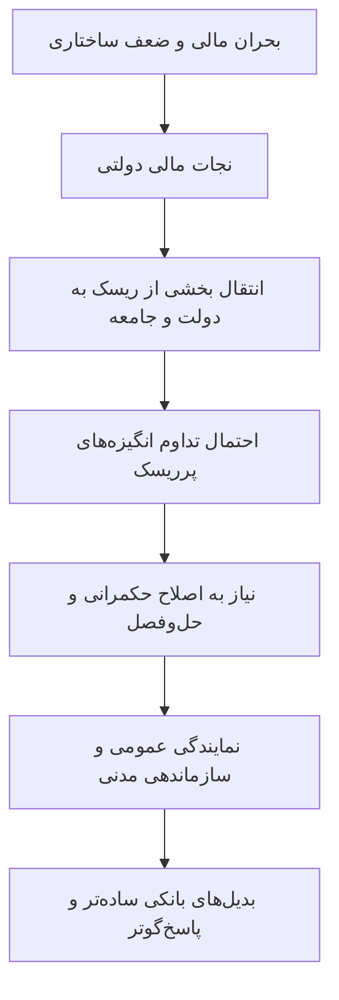

# ماتیک روی خوک: چرا نجات‌های مالی شکست می‌خورند و قدرت مردم پیروز خواهد شد
## *Lipstick on a Pig: Why Bail-outs Fail and People Power Will Succeed*

> [!important] تمایز کتاب‌شناختی
> این کتاب نوشته **Simon Deane-Johns** در سال **۲۰۱۲** است؛ با کتاب هم‌نام *Lipstick on a Pig: Winning in the No-Spin Era* نوشته **Torie Clarke** در سال ۲۰۰۶ تفاوت دارد. دو کتاب از استعاره مشترکی استفاده می‌کنند، اما موضوع و استدلالشان جداست.

## ۱. شناسنامه کتاب

- **نویسنده:** Simon Deane-Johns، هم‌بنیان‌گذار Zopa و نویسنده‌ای با تمرکز بر خدمات مالی و تحول نهادی.
- **ناشر:** Searching Finance, Limited.
- **سال انتشار:** ۲۰۱۲.
- **طول نسخه فهرست‌شده:** ۱۲۴ صفحه.
- **ساختار معرفی‌شده در Google Books:** پنج فصل.
- **حوزه:** بانکداری، تنظیم‌گری مالی، اقتصاد سیاسی، نهادهای مدنی و بدیل‌های سازمانی.

منبع کتاب‌شناختی: [Google Books](https://books.google.com/books/about/Lipstick_on_a_Pig.html?id=eqKSpwAACAAJ). معرفی کتاب آن را نخستین عنوان از مجموعه‌ای درباره تغییر رابطه جامعه با نهادها، شخصی‌سازی خدمات و ساختارهای مشارکتی معرفی می‌کند. 

## ۲. تز مرکزی کتاب

بر اساس متن مفاهیمی که ارائه کرده‌اید، تز کتاب این است که کمک‌های مالی دولتی به بانک‌های گرفتار بحران ممکن است ساختارهایی را حفظ کند که خود در شکل‌گیری بحران نقش داشته‌اند؛ درحالی‌که بخشی از هزینه به جامعه منتقل می‌شود و انگیزه اصلاح عمیق کاهش می‌یابد. استعاره «رژ لب روی خوک» نامی برای همین نقد است: تغییر ظاهری، نقص ساختاری را حل نمی‌کند.

در برابر این وضعیت، نویسنده بر قدرت مردم، سازماندهی مدنی، نمایندگی منافع عمومی و الگوهای مالی با مأموریت ساده‌تر و پاسخ‌گوتر تأکید می‌کند. این بخش، موضع سیاستی نویسنده است؛ برای سنجش اعتبار آن باید با شواهد مربوط به هر برنامه نجات مالی و بدیل‌های نهادی مقایسه شود.

## ۳. ساختار کلی کتاب طبق اطلاعات کتاب‌شناختی

اطلاعات Google Books می‌گوید کتاب در پنج فصل سازمان یافته است:

1. ظهور عمل‌گرایی از میل پایین‌به‌بالا برای یافتن آنچه واقعاً کار می‌کند؛
2. تمایز میان «نهادهایی» که بیشتر مسائل خود را حل می‌کنند و «تسهیل‌گرانی» که روی مسئله مشتری تمرکز دارند؛
3. محیط اقتصادی نظام مالی، شامل طمع، خطای انسانی و کمبود تفکر انتقادی؛
4. تحول خدمات مالی در بستر تغییرات اجتماعی و نهادی؛
5. نقد تنظیم‌گری مالی و پیشنهاد تغییراتی برای رشد خدمات مالی ساده، کم‌هزینه و مفید. 

این ساختار را از معرفی کتاب‌شناختی نقل می‌کنیم؛ فهرست تفصیلی زیرعنوان‌های هر فصل در خلاصه ارسالی موجود نبود.

## ۴. یادداشت‌های مفهومی مستقل

### استعاره و نقد ساختاری
- [[استعاره رژ لب روی خوک در نظام مالی]]
- [[نجات مالی بانک‌ها]]
- [[خصوصی‌سازی سود و اجتماعی‌سازی زیان]]
- [[هزینه واقعی نجات مالی و ارزش‌گذاری]]
- [[ذی‌نفعان واقعی نجات مالی]]

### ریسک و ساختار بانکی
- [[چرخه بانک و دولت]]
- [[کژمنشی و مخاطره اخلاقی]]
- [[معضل بسیار بزرگ برای ورشکست شدن]]
- [[حل‌وفصل منظم بانک‌های بحران‌زده]]

### بدیل‌های دموکراتیک و عمومی
- [[قدرت مردم و سازماندهی مدنی]]
- [[مالکیت عمومی و بازخرید دموکراتیک]]
- [[نمایندگی منافع عمومی در بانکداری]]
- [[مسئله اقدام جمعی و سازمان‌های جامعه مدنی]]
- [[بانکداری ذی‌نفعان و بانکداری ساده]]
- [[روایت عمومی و اقدام جمعی]]
- [[ارزش اجتماعی و اقتصادی فراتر از GDP]]
- [[کالاهای گروهی و سواری‌بگیران رایگان]]

### جهت‌گیری نهادی
- [[نهادها در برابر تسهیل‌گران]]
- [[رویکرد عمل‌گرا و تغییر نهادی]]

## ۵. جمع‌بندی استدلال در یک نگاه

این نمودار بازسازی تحلیلیِ خلاصه ارسالی است، نه نمودار رسمی چاپ‌شده در کتاب.

## ۶. ملاحظات انتقادی: تز نویسنده در برابر شواهد مستقل

### ۶.۱. نجات مالی یک ابزار واحد نیست

کمک عمومی می‌تواند شکل‌های متفاوتی داشته باشد: سرمایه‌گذاری در بانک، تضمین بدهی، وام اضطراری، خرید دارایی یا حمایت از سپرده‌گذاران. ارزیابی باید مشخص کند کدام ابزار اجرا شده و هزینه و شرط‌های آن چه بوده است.

### ۶.۲. مبلغ ناخالص با هزینه نهایی یکی نیست

GAO گزارش می‌کند که تا پایان برنامه TARP در ۳۰ سپتامبر ۲۰۲۳، مجموع پرداخت‌ها ۴۴۳٫۵ میلیارد دلار و هزینه نهایی خالص برنامه‌های تأمین‌شده از TARP پس از بازپرداخت‌ها، فروش دارایی‌ها، سود سهام، بهره و سایر درآمدها ۳۱٫۱ میلیارد دلار بود. بخش مهمی از هزینه نهایی به برنامه‌های جلوگیری از سلب مالکیت مسکن، حمایت از AIG و صنعت خودرو مربوط می‌شد؛ برخی معاملات با مؤسسات مالی نیز به‌دلیل درآمدها و سود سرمایه‌ای به سود خالص دولت انجامیدند. 

این ارقام به معنی رد نقد کتاب نیستند؛ نشان می‌دهند که ادعای کلی «همه نجات‌های مالی شکست می‌خورند» را نمی‌توان تنها با مبلغ ناخالص کمک‌ها اثبات کرد. باید اثر ثبات مالی، توزیع منافع، هزینه فرصت و پیامدهای بلندمدت را جداگانه بررسی کرد.

### ۶.۳. چرخه بانک–دولت واقعیت تحلیلی دارد، اما سازوکارش چندعاملی است

IMF توضیح می‌دهد که وضعیت بانک‌ها و دولت‌ها می‌تواند از طریق دارایی‌های بانکی، تضمین‌های عمومی، هزینه تأمین مالی و رکود اقتصادی به یکدیگر منتقل شود و حلقه‌های بازخورد منفی بسازد. 

### ۶.۴. مالکیت عمومی تضمین موفقیت نیست

بانک‌های عمومی می‌توانند اهداف توسعه‌ای و محیط‌زیستی را دنبال کنند، ولی عملکرد آن‌ها به حکمرانی، ظرفیت، نمایندگی، شفافیت و پاسخ‌گویی بستگی دارد. پژوهش درباره بانک‌های عمومی بر این نکته تأکید دارد که این نهادها ذاتاً خوب یا بد نیستند. 

## ۷. پرسش‌هایی برای مطالعه انتقادی

- آیا هدف نجات، حفظ سهام‌داران بود یا حفاظت از سپرده‌گذاران و زیرساخت پرداخت؟
- چه کسانی در هر برنامه کمک دریافت کردند و چه کسانی زیان دیدند؟
- آیا دولت شروطی برای بازسازی، تغییر مدیریت یا محدودکردن ریسک تعیین کرد؟
- هزینه ناخالص، هزینه نهایی مالی دولت و هزینه اجتماعی چه تفاوتی دارند؟
- کدام نهاد عمومی یا مدنی واقعاً نماینده سپرده‌گذاران، وام‌گیرندگان و کارکنان است؟
- برای مقایسه بانک خصوصی، تعاونی و عمومی از چه شاخص‌هایی باید استفاده کرد؟
- آیا ادعای نویسنده درباره یک کشور یا بحران خاص قابل تعمیم به کشورها و دوره‌های دیگر است؟

## ۸. منابع منتخب

1. [Google Books — شناسنامه و معرفی کتاب](https://books.google.com/books/about/Lipstick_on_a_Pig.html?id=eqKSpwAACAAJ)
2. [U.S. GAO — هزینه نهایی برنامه TARP، دسامبر ۲۰۲۳](https://www.gao.gov/products/gao-24-107033)
3. [Congressional Budget Office — گزارش TARP، آوریل ۲۰۲۳](https://www.cbo.gov/publication/59062)
4. [Financial Stability Board — پایان دادن به معضل Too-Big-To-Fail](https://www.fsb.org/work-of-the-fsb/market-and-institutional-resilience/post-2008-financial-crisis-reforms/ending-too-big-to-fail/)
5. [IMF — پیوند بانک و دولت](https://www.elibrary.imf.org/view/journals/087/2018/016/article-A001-en.xml)
6. [IMF Global Financial Stability Report — پیوند بانک–حاکمیت](https://www.imf.org/en/publications/gfsr/issues/2022/04/19/global-financial-stability-report-april-2022)
7. [Marshall Ganz et al. — روایت عمومی و کنش جمعی، ۲۰۲۳](https://www.hks.harvard.edu/publications/crafting-public-narrative-enable-collective-action-pedagogy-leadership-development)
8. [Cambridge University Press — Public Banks](https://www.cambridge.org/core/books/public-banks/0EC8E41F837E1F10BE53FC31DA83D012)

#کتاب #اقتصاد-سیاسی #بانکداری #بحران-مالی #قدرت-مردم
